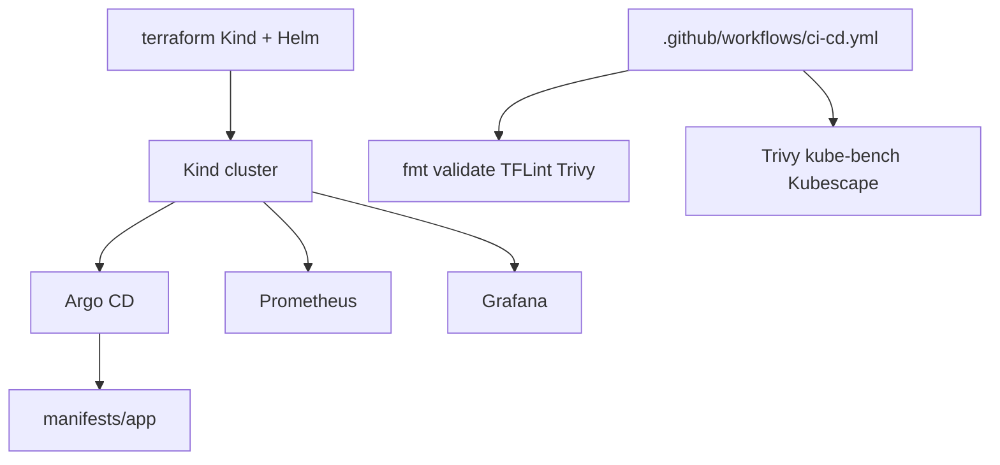

# Cloud DevOps Platform

Local Kind GitOps platform foundation with Terraform, Argo CD, and monitoring.

[](https://github.com/justrunme/cloud-devops-platform/actions/workflows/ci-cd.yml)
[](https://github.com/justrunme/cloud-devops-platform/releases/latest)
[](LICENSE)
[](https://justrunme.com/cases/eks-platform-foundation/)
[](https://securityscorecards.dev/viewer/?uri=github.com/justrunme/cloud-devops-platform)

Case study: [EKS Platform Foundation](https://justrunme.com/cases/eks-platform-foundation/) · [Andrey Lesnikov](https://justrunme.com/)

## What it does

- Provisions a Kind cluster with Terraform and deploys Argo CD, Prometheus, and Grafana via Helm
- Syncs a demo application from `manifests/app` through an Argo CD `Application`
- Runs CI for `terraform fmt` / `validate`, TFLint, Trivy config, plus cluster security scans

## Why

- Platform foundations should be reproducible IaC with GitOps delivery and baseline security gates
- Local Kind keeps the same Terraform/Helm patterns available without a cloud account

## Quickstart

```bash
cd terraform
terraform init
terraform apply -auto-approve -target=kind_cluster.default -target=local_file.kubeconfig
export KUBECONFIG="$PWD/kubeconfig"
terraform apply -auto-approve
```

## Architecture



## Overview

The stack includes:

- **Infrastructure as Code** with Terraform (Kind cluster, Helm releases, Kubernetes manifests)
- **GitOps** application delivery with Argo CD
- **Monitoring** with Prometheus and Grafana
- **Security scanning** with Trivy, kube-bench, and Kubescape
- **CI** with GitHub Actions (`terraform fmt`, `validate`, TFLint, Trivy config, plus cluster security jobs)

## Repository Structure

```
cloud-devops-platform/
├── README.md
├── CHANGELOG.md
├── SECURITY.md
├── LICENSE
├── terraform/
│   ├── providers.tf             # Terraform and provider versions
│   ├── kind_cluster.tf          # Kind cluster and kubeconfig file
│   ├── k8s_resources.tf         # Argo CD, Prometheus, Grafana, demo Application
│   └── argocd-values.yaml       # Argo CD Helm values
├── manifests/
│   └── app/                     # Demo application manifests
├── monitoring/
│   ├── prometheus-values.yaml
│   ├── grafana-values.yaml
│   └── grafana-dashboards/
├── security/
│   ├── run_trivy.sh
│   └── kube-bench-config.yaml
└── .github/
    ├── dependabot.yml
    └── workflows/
        └── ci-cd.yml
```

## Project Goals

| Goal           | Description                                                                 |
|----------------|-----------------------------------------------------------------------------|
| **GitOps**     | Deploy the demo app from `manifests/app` via an Argo CD `Application`.      |
| **IaC**        | Define the Kind cluster, Helm charts, and monitoring as Terraform code.     |
| **CI**         | Fail the pipeline on format, validate, lint, and policy-scan regressions.   |
| **Security**   | Run Trivy, kube-bench, and Kubescape against the provisioned Kind cluster.  |
| **Monitoring** | Install Prometheus and Grafana with a sample Kubernetes dashboard ConfigMap.|

## Getting Started

### Prerequisites

- [Docker](https://docs.docker.com/get-docker/) (required by Kind)
- [Kind](https://kind.sigs.k8s.io/docs/user/quick-start/) (optional CLI; Terraform provider embeds Kind)
- [Terraform](https://developer.hashicorp.com/terraform/install) `>= 1.6`
- [kubectl](https://kubernetes.io/docs/tasks/tools/)

### Installation

1. Clone the repository:

```sh
git clone https://github.com/justrunme/cloud-devops-platform.git
cd cloud-devops-platform
```

2. Initialize Terraform:

```sh
cd terraform
terraform init
```

3. Apply in two phases (cluster first, then workloads):

```sh
terraform apply -auto-approve -target=kind_cluster.default -target=local_file.kubeconfig
export KUBECONFIG="$PWD/kubeconfig"
terraform apply -auto-approve
```

The Kind cluster uses Kubernetes `v1.34.3` (node image pinned to a digest published with kind `v0.31.0`, matching `tehcyx/kind` `~> 0.11`). Argo CD, Prometheus, and Grafana are installed with Helm via Terraform.

### Local validation

```sh
cd terraform
terraform init -backend=false
terraform fmt -check -recursive
terraform validate
tflint --init && tflint
actionlint
```

## CI Pipeline

`.github/workflows/ci-cd.yml` runs on pushes and pull requests to `main`:

1. **Validate and Lint** — `terraform fmt -check`, `terraform init -backend=false`, `terraform validate`, TFLint, and `trivy config terraform` (HIGH/CRITICAL fail the job).
2. **Security Scans** — provisions Kind with Terraform, installs the stack, then runs Trivy Kubernetes scan, kube-bench, and Kubescape.

Kubeconfig is generated by Terraform (`local_file.kubeconfig`); no repository secret is required for the Kind-based workflow.

## Versions (pinned in code)

| Component              | Version / constraint                                      |
|------------------------|-----------------------------------------------------------|
| Terraform CLI (CI)     | `1.16.5`                                                  |
| kind provider          | `~> 0.11` (`tehcyx/kind`)                                 |
| kubernetes provider   | `~> 3.0`                                                  |
| helm provider          | `~> 3.0`                                                  |
| Kind node image        | `kindest/node:v1.34.3` (digest from kind `v0.31.0`)       |
| Argo CD Helm chart     | `10.10.2`                                                 |
| Prometheus Helm chart  | `29.36.1`                                                 |
| Grafana Helm chart     | `10.5.15`                                                 |

## Accessing Grafana

```sh
export KUBECONFIG="$PWD/terraform/kubeconfig"
kubectl -n monitoring port-forward svc/grafana 3000:3000
```

Open `http://localhost:3000` (default credentials come from the Grafana chart values / release notes; change them after first login).

## Security

See [SECURITY.md](SECURITY.md) for supported versions and private vulnerability reporting via GitHub Security Advisories.

## License

See [LICENSE](LICENSE).

